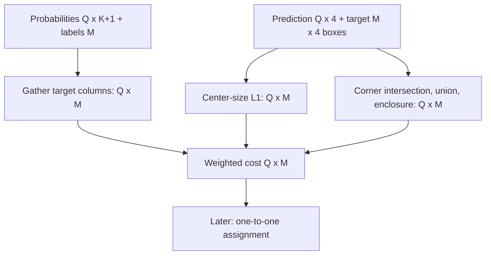

# Theory

## Intuition: compare every proposed object with every real object

A detector emits several candidate boxes without knowing which candidate should learn from which labeled object. The cost matrix answers a smaller question: how suitable is each query for each target? Classification, location, and overlap provide complementary evidence. A low cost means a better pairing. It can be negative; it is not a probability.

The assignment solver consumes this matrix later and enforces one-to-one ownership. Taking each row's cheapest target independently can assign several queries to the same object. That is why matching cost construction and assignment are separate components.

## Class agreement and box distance

Let $Q$ be query count, $M$ target count, and $K$ real classes. Query probabilities $P\in\mathbb R^{Q\times(K+1)}$ include background in column $K$, but each target label $c_j$ is below $K$. Boxes $b_i,\hat b_j\in\mathbb R^4$ use normalized image coordinates $(c_x,c_y,w,h)$; all entries and costs are dimensionless. Image x points right and y points down.

With nonnegative scalar weights $\lambda_c,\lambda_1,\lambda_g$, construct

$$
C_{ij}=-\lambda_c P_{i,c_j}
       +\lambda_1\|b_i-\hat b_j\|_1
       -\lambda_g\operatorname{GIoU}(b_i,\hat b_j).
$$

Using $-\log P_{i,c_j}$ here would change this contract. Log probability belongs to the later classification training objective. L1 compares four center/size coordinates, not four corners; changing representation changes its value.

## Why generalized IoU helps disjoint boxes

Convert a box to corners $(c_x-w/2,c_y-h/2,c_x+w/2,c_y+h/2)$. Let $I$ be intersection area, $U$ union area, and $E$ the area of the smallest axis-aligned rectangle enclosing both boxes. The declared minimum width/height of $10^{-6}$ keeps converted corners distinct in float64 at these normalized centers, so $U,E>0$. Arbitrarily tiny positive sizes could round both corners to the same number; this task rejects those inputs.

$$
\operatorname{IoU}=I/U,\qquad
\operatorname{GIoU}=I/U-(E-U)/E.
$$

For Example 2, $I=0$, $U=0.08$, $E=0.14$, so $\operatorname{GIoU}=-3/7$ and $C_{00}=0.3285714286$. Disjoint boxes no longer all receive the same overlap term. `1-GIoU` differs from `-GIoU` by a constant per pair: it preserves an assignment with fixed cardinality but fails this exact matrix contract.

## Visual: three aligned pairwise tables

Text alternative: each output cell combines the class score for one target label, four-coordinate L1 distance, and generalized IoU for that same query/target pair. No axis represents time or a batch. Example 1's rows are `[-1.8,0.4]` and `[0.3,-1.7]`.

## Why this matters on a robot

An incorrect class axis or box convention can teach a manipulator to associate the right category with the wrong image region. Detection output must still pass through the camera's resize/calibration transform before 3D use. A correct matching matrix alone provides neither calibrated uncertainty nor grasp geometry. Log class/L1/GIoU magnitudes separately when diagnosing a training change.

Prerequisite: [pairwise IoU](../../../problems/box-iou-broadcast/problem.md). Source: [DETR, section 3.1 and Appendix A.2](https://arxiv.org/abs/2005.12872); the [official matcher](https://github.com/facebookresearch/detr/blob/main/models/matcher.py) verifies the negative-GIoU convention. This exercise uses supplied probabilities and one image, without a transformer, loss backpropagation, or assignment solver.

## Check your understanding

1. Would replacing negative GIoU with one minus GIoU change this matrix? Would it change a fixed-cardinality optimal assignment?
2. Why can independently choosing each query's cheapest target fail to give a valid matching?

Discuss these after working through the numerical example. Answers are in [examples.md](examples.md).
