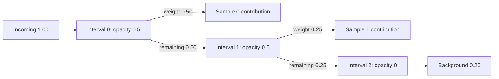

# Theory

## Intuition: only unblocked light reaches later intervals

Consider a ray passing through a stack of thin translucent layers. Each layer absorbs some of the mass that actually reaches it. A dense layer behind an almost opaque layer contributes little, even if its own density is large. Rendering therefore combines each interval's opacity with its visibility from the camera.

This exercise stops at those weights. Multiplying them by RGB values or distances is a later operation. The remaining mass is retained explicitly so a caller can apply its chosen background model.

## Density, distance, and opacity

Let $\sigma_{ri}\ge0$ be density in inverse metres and $\Delta_{ri}\ge0$ be physical interval length in metres. $r$ indexes one of $R$ rays and $i$ one of $S$ intervals, ordered near-to-far. The arrays have shape $(R,S)$. Their product $q_{ri}=\sigma_{ri}\Delta_{ri}$ is dimensionless optical thickness.

$$
\alpha_{ri}=1-\exp(-q_{ri}),\qquad
T_{ri}=\exp\left(-\sum_{j<i}q_{rj}\right),\qquad
w_{ri}=T_{ri}\alpha_{ri}.
$$

$T$ is exclusive transmittance: the first interval always starts at $T_{r0}=1$, regardless of its density. An inclusive cumulative sum would attenuate the first interval before it has had a chance to contribute.

The final background mass is

$$
b_r=\exp\left(-\sum_{i=0}^{S-1}q_{ri}\right),\qquad
\sum_{i=0}^{S-1}w_{ri}+b_r=1.
$$

The identity follows because each weight is the difference between transmittance before and after its interval; intermediate terms cancel. It is a useful check, but not sufficient alone: renormalizing incorrect weights can also force a sum of one.

## Worked ray and visual

For Example 1, $q=[\log2,\log2,0]$, so $\alpha=[0.5,0.5,0]$, $T=[1,0.5,0.25]$, and $w=[0.5,0.25,0]$. Background is $0.25$.

Text alternative: start with one unit of mass; interval 0 takes 0.50, interval 1 takes 0.25, interval 2 takes zero, leaving 0.25. The weights are fractions of original incoming mass, not independent opacities.

For tiny thickness, computing $1-\exp(-q)$ subtracts nearly equal numbers; $-\operatorname{expm1}(-q)$ retains small values. Very large thickness can underflow transmittance to zero, which correctly models negligible visibility under this contract.

## Why this matters on a robot

Using an unnormalized ray direction while treating ray parameters as metres changes optical thickness and learned scene scale. Converting metres to centimetres requires inverse conversion of density. These interfaces must agree before a rendered scene supports any depth or mapping evaluation. Good rendered appearance still does not establish a safe collision map.

Prerequisite: [camera projection](../../../problems/project-camera-points/problem.md). Source: [NeRF section 4](https://arxiv.org/abs/2003.08934). This finite-interval exercise has no infinite final interval, hierarchical sampler, neural field, or claim to reproduce NeRF results.

## Check your understanding

1. Why do sample weights sum to0.75 in Example1 rather than1?
2. If all interval lengths are converted from metres to centimetres, how should density change to preserve weights?

Discuss these after working through the numerical example. Answers are in [examples.md](examples.md).
