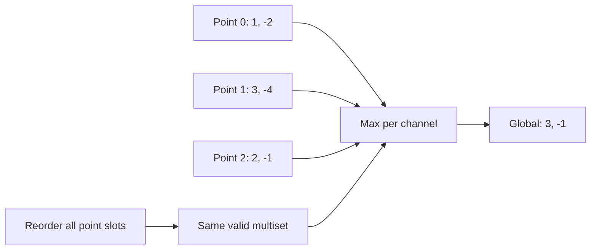

# Theory

## Intuition: a cloud has no privileged input order

A depth driver can enumerate the same measured points in a different order after filtering or transport. A global descriptor should not change just because that enumeration changes. PointNet applies a shared feature function to each point and then uses a symmetric reduction. Here the shared features are already supplied, allowing the reduction and its invariance to be tested on their own.

Maximum pooling asks whether any valid point supplies a strong response in each learned channel. Different channels may select different points. The result is not necessarily the feature vector of any actual point.

## Define the masked maximum

Let $F\in\mathbb R^{B\times N\times D}$ contain dimensionless features for $B$ clouds, $N$ point slots, and $D$ channels. Let $m_{bn}\in\{0,1\}$ mark valid slots. At least one slot is valid in each cloud. The output $G\in\mathbb R^{B\times D}$ is

$$
G_{bd}=\max_{n:\,m_{bn}=1}F_{bnd}.
$$

When no mask is supplied, all $m_{bn}$ are one. Masked slots can be represented internally by $-\infty$ for reduction, even though input features must be finite. Zero is not a neutral value for a maximum over negative features. An all-invalid cloud has no finite maximum under this contract and is rejected.

## Why every permutation gives the same result

For one cloud let $\pi$ be a bijection of the point indices. Apply it to both features and mask: $F'_{nd}=F_{\pi(n)d}$ and $m'_n=m_{\pi(n)}$. Then

$$
\max_{n:\,m'_n=1}F'_{nd}
=\max_{n:\,m_{\pi(n)}=1}F_{\pi(n)d}
=\max_{k:\,m_k=1}F_{kd}.
$$

The last equality simply renames the same valid set. It does not assert rotation invariance, because rotating XYZ inputs can change the computed features. It also does not make a per-point segmentation output invariant; that output should reorder along with the points, a property called equivariance.

## Worked example and visual

Example 1 reduces the first channel `[1,3,2]` to 3 and the second `[-2,-4,-1]` to -1. Reordering to point indices `[2,0,1]` gives `[2,1,3]` and `[-1,-2,-4]`, with the same maxima.

Text alternative: all valid rows feed one maximum operation per feature column. The first output comes from point 1, the second from point 2. Invalid rows are excluded from both. No sorting or temporal order is required.

## Why this matters on a robot

Permutation invariance prevents driver ordering from changing a cloud descriptor. It cannot recover missing geometry: removing the point that supplied a channel maximum can change the result. Duplicate points do not change max pooling, so point counts and density are lost. A padded-cloud bug can overwhelm valid geometry, particularly when negative activations meet zero padding. Version the mask-generation and cloud preprocessing paths together.

Prerequisite: [SE(3) point transforms](../../../problems/se3-transform-points/problem.md) for upstream frame consistency. Source: [PointNet section 4.2](https://arxiv.org/abs/1612.00593). This task covers symmetric aggregation and an elementary invariance proof, not the paper's approximation theorem, training, or segmentation network.

## Check your understanding

1. Why must the validity mask be permuted along with point features?
2. Does adding a duplicate valid feature row change the descriptor? Does that prove robustness to missing points?

Discuss these after working through the numerical example. Answers are in [examples.md](examples.md).
