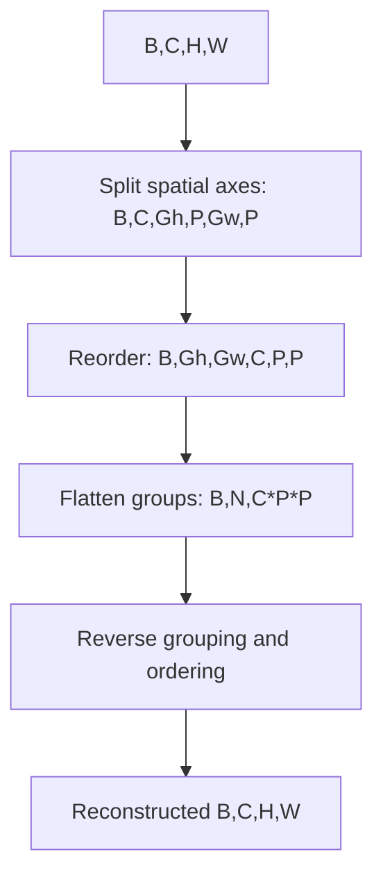

# Theory

## Intuition: make local image regions into a sequence

Before attention can process an image, ViT groups a fixed pixel neighborhood into each token. Patchification is an indexing operation: it preserves every pixel and does not learn anything. A later learned projection changes vector width. Keeping those two stages separate makes it possible to test the image-to-token boundary without a model checkpoint.

A round trip is necessary but not sufficient. Two functions can share the same wrong permutation and still reconstruct the input. Therefore the expected patch order must also be checked directly.

## Define the indexing contract

Let $I\in\mathbb R^{B\times C\times H\times W}$ be the input image batch. $B$ is batch size, $C$ channel count, and $H,W$ are pixel height/width. Patch side $P$ is measured in pixels and divides both spatial dimensions. Define grid sizes $G_h=H/P$, $G_w=W/P$, patch count $N=G_hG_w$, and vector width $D=CP^2$.

For grid row $r$, grid column $s$, channel $c$, and local patch coordinates $a,b\in\{0,\ldots,P-1\}$, the required output $X\in\mathbb R^{B\times N\times D}$ is

$$
X_{n,\,rG_w+s,\,cP^2+aP+b}=I_{n,c,rP+a,sP+b}.
$$

The batch index $n$ never mixes with patch positions. The image y axis is row/down and x is column/right. Values retain their original intensity units. Reconstruction applies this same equation in reverse; no averaging is needed because patches do not overlap.

## Worked shape and pixel trace

For Example 1, $(B,C,H,W)=(1,1,2,4)$ and $P=2$, so $G_h=1$, $G_w=2$, $N=2$, $D=4$. The pixel at row 1, column 2 is 7. Its grid column is 1, local row 1, local column 0, so it becomes token 1, element 2. The two tokens are `[1,2,5,6]` and `[3,4,7,8]`.

Text alternative: divide height into grid-row/local-row and width into grid-column/local-column; move the two grid axes before the channel/local axes; then flatten each group. Reverse those steps to reconstruct the image. The explicit index equation above is authoritative even if a different correct implementation avoids a transpose.

## Why this matters on a robot

An encoder checkpoint expects both patch order and preprocessing order. A shape-correct channel interleave can corrupt camera features without a runtime error. Record channel layout, resize/crop policy, patch size, and positional-grid convention in the model package. Smaller patches retain finer spatial neighborhoods but increase token count; no patchification function itself recovers details lost by resizing.

Prerequisites are image tensor axes; this is a perception interface exercise, not a general Python lesson. Source: [ViT section 3.1](https://arxiv.org/abs/2010.11929). The task stops before projection, position embeddings, class tokens, attention, and classification. The diagrams and sample pixels here are original.

## Check your understanding

1. Why does a successful patchify/unpatchify round trip not prove that token order matches a checkpoint?
2. For Example 1, where does pixel 7 go in the patch tensor?

Discuss these after working through the numerical example. Answers are in [examples.md](examples.md).
