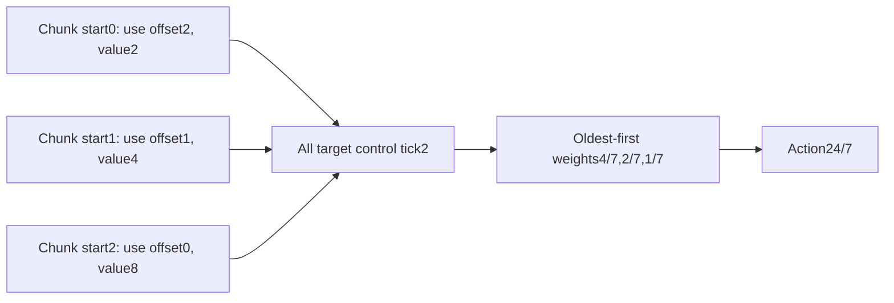

# Blend Overlapping Action Chunks with Temporal Ensembling: theory

## Intuition

At tick2, a chunk predicted at tick0, another at tick1, and a new chunk can all estimate the action to execute now. Temporal ensembling compares those estimates of the **same physical time**. It does not smooth neighboring actions from different times along one trajectory.

## Align before averaging

Let $P\in\mathbb R^{C\times H\times D}$ store chunks with starts $s_c$ and target tick $t$. Chunk $c$ contributes its entry

$$
h_c=t-s_c,\qquad a^{(c)}=P_{c,h_c,:},
$$

only when $0\le h_c<H$ and $V_{c,h_c}=1$. $C$ counts historical predictions, $H$ future offsets, and $D$ action channels. Ticks convert to seconds only through the caller’s fixed control period. The values being averaged are normalized Euclidean actions in one consistent frame.

## Use ACT’s rank direction

Order eligible chunks by increasing start tick. Let $c_i$ be the index of rank $i$, with $i=0$ the oldest eligible prediction. For decay $m\ge0$,

$$
\widetilde w_i=e^{-mi},\qquad w_i=\frac{\widetilde w_i}{\sum_{j=0}^{M-1}\widetilde w_j},\qquad \bar a=\sum_iw_iP_{c_i,t-s_{c_i},:}.
$$

This is the convention stated in ACT. Increasing $m$ gives more influence to older predictions; $m=0$ gives an ordinary mean. Defining $i$ as “age from newest” would reverse the behavior and implement a different policy. In this task, gaps in start ticks and masked candidates do not create gaps in rank.

The first raw weight is exactly1, so the denominator stays positive even when later weights underflow toward zero. Float64 accumulation limits avoidable rounding before returning the input dtype.

## Worked calculation

At target tick2, select values2,4,8 from horizon offsets2,1,0. With $m=\log2$, raw weights are $1,1/2,1/4$, summing to $7/4$. The result is

$$
\bar a=\frac{2+2+2}{7/4}=\frac{24}{7}.
$$

Using the same horizon offset for every chunk would mix different physical times even though all selected arrays have shape $(D,)$.

## Original alignment diagram

Text alternative: align the three chunks diagonally across their horizon axes so every chosen entry targets tick2. Only after alignment apply the oldest-first weights and sum corresponding channels.

## Why this matters on a robot

Older predictions may give smoother behavior but incorporate new observations more slowly. A mask inferred from nonzero values can remove legitimate holding or zero-velocity commands. Mixing frames, normalization versions, or wrapped orientation representations invalidates an otherwise correct weighted average. Evaluate response to scene changes as well as smoothness.

## Check your understanding

1. With ACT’s stated oldest-first indexing, does increasing decay favor older or newer predictions?
2. If a chunk starts at tick4, which horizon offset predicts target tick7?
3. Why are quaternion components and wrapped angles excluded from this Euclidean averaging contract?

## Sources and prerequisites

[Primary paper](https://arxiv.org/abs/2304.13705). This exercise implements ACT’s temporal ensembling after chunk predictions already exist. It follows the primary paper’s oldest-first rank convention. Explicit validity masks, nonconsecutive start ticks, and returned diagnostic weights are teaching extensions; normalized Euclidean channels exclude quaternion averaging and wrapped-angle interpolation.

Prerequisite concepts: action chunks, control-tick alignment, and weighted averages. No Python syntax or general mathematics lesson is required.
