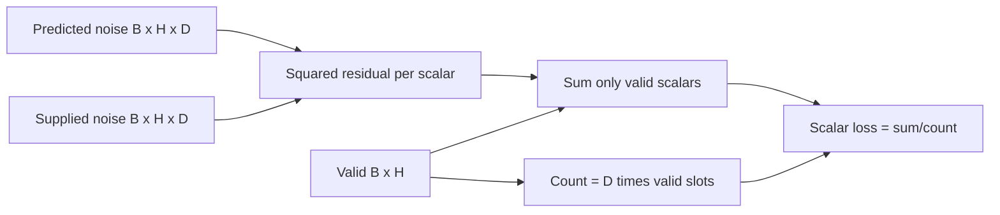

# Compute a Conditional Noise-Prediction Loss: theory

## Intuition

Training can create its own supervised target: add a known noise sample to a clean action chunk, ask a conditioned network to predict that noise, and compare the answer with the noise that was actually used. The loss must exclude nonexistent padded actions without changing the relative weight of real scalar targets.

## From conditioning to residuals

An upstream denoiser computes $\widehat E=\epsilon_\theta(A^{(k)},k,c)$, where $c$ is observation context, $k$ is diffusion level, and $A^{(k)}$ is a corrupted action chunk. Both $\widehat E$ and supplied noise $E$ have shape $(B,H,D)$. The horizon index is robot time; $k$ is a separate noise-level index.

This task begins after that model call. Let $M\in\{0,1\}^{B\times H}$ be valid horizon slots and

$$
N_{\mathrm{valid}}=D\sum_{b,h}M_{bh}.
$$

With at least one valid slot,

$$
L=\frac{1}{N_{\mathrm{valid}}}\sum_{b,h,d}M_{bh}(\widehat E_{bhd}-E_{bhd})^2.
$$

Every symbol maps to an input: $\widehat E$ is prediction, $E$ is target_noise, and $M$ is valid. Noise is dimensionless in the normalized action representation. It is not a physical sensor-noise covariance or a motor command.

## Why the denominator includes D

Validity has no channel axis because an entire action vector is either present or padding. Each valid vector contains $D$ scalar errors. Dividing only by $\sum M$ would return a sum across channels and make the loss scale with action dimensionality. Dividing by $BHD$ would let padding dilute the loss.

The prediction gradient is

$$
\frac{\partial L}{\partial\widehat E_{bhd}}=\frac{2M_{bh}(\widehat E_{bhd}-E_{bhd})}{N_{\mathrm{valid}}}.
$$

The target gradient is its negative when the caller enables target gradients. This function must not detach either tensor. A trainer can deliberately detach supplied targets before calling it.

## Worked calculation

For valid residuals $(1,2)$ and a second padded action vector, $N_{\mathrm{valid}}=2$. The loss is $(1+4)/2=2.5$, with prediction gradient $(1,2)$ at the valid location and zero at padding. In the second example, valid scalar errors4,4,16 give8; equal weighting of two per-item means would incorrectly give7.

## Original loss diagram

Text alternative: subtract supplied noise from predicted noise, square the residuals, remove padded horizon vectors, sum all remaining channel errors, and divide by the number of those scalar entries.

## Why this matters on a robot

Different demonstrations can have different valid tail lengths. Per-item averaging changes how much each recorded action influences learning; padding dilution makes losses incomparable across batches. Low training noise error still does not prove closed-loop success, and a checkpoint must retain its action normalization and prediction parameterization.

## Check your understanding

1. Why is the target supplied noise rather than the clean action chunk?
2. Why does the denominator multiply the valid-slot count by D?
3. How can equal averaging of per-item losses change the objective when episode tails differ?

## Sources and prerequisites

[Primary paper](https://arxiv.org/abs/2303.04137). This component computes the masked noise-regression reduction after a conditional denoiser has run. It does not build that network, sample timesteps/noise, construct noised actions, or duplicate the published forward-noising problem. Validity masking and the exact global reduction are explicit teaching contracts.

- [diffusion-action-noising](/problems/diffusion-action-noising)
