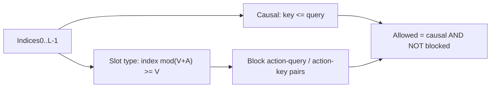

# Build a Causal Action-Token Mask: theory

## Intuition

Causality answers “is this information from the future?” The RT-1 reference mask adds a second question for action queries: “is this key itself an action slot?” Both checks matter. A generic autoregressive lower triangle would allow an action query to attend directly to preceding action slots, which is not the specified relation.

## Locate each token

Let $T$ be timesteps, $V$ visual slots per timestep, and $A$ action slots. The block width is $S=V+A$ and sequence length is $L=TS$. Position $i$ belongs to timestep $\lfloor i/S\rfloor$ and is an action slot when

$$
q_i=\mathbf1[(i\bmod S)\ge V].
$$

Here $q_i$ is a type indicator, not a robot joint position. No physical coordinate frame or continuous time is represented. Sequence order is oldest to newest.

## Combine the two rules

The boolean mask is

$$
M_{ij}=\mathbf1[j\le i]\land\neg(q_i\land q_j).
$$

Rows are queries and columns are keys. The visual diagonal is allowed; the action diagonal is blocked. For an action query, the first term prevents future visual observations and the second removes all causal action keys. A later visual query still sees earlier action placeholders because $q_i=0$ makes the second restriction inactive.

## Worked calculation

For $T=2,V=A=1$, slots are $(V_0,A_0,V_1,A_1)$ and type indicators are $(0,1,0,1)$. Query $A_1$ has index3. All columns satisfy $j\le3$, but columns1 and3 are action slots, so its row is $(1,0,1,0)$. Query $V_1$ has index2 and no action-query restriction, giving $(1,1,1,0)$.

## Original mask diagram

Text alternative: classify every slot by its position in a timestep block, construct a lower triangle, and clear only cells whose row and column are both action slots. In the four-slot example, the resulting rows are1000,1000,1110,1010.

## What the mask does not guarantee

The official implementation also replaces input action embeddings with zeros. The mask and that input convention work together. If a different implementation inserts target action values, a later visual token could attend to an earlier target, then pass information onward. Therefore this function must not be advertised as a complete teacher-forcing leakage solution. Prediction-position shifts are another model-level decision outside the mask contract.

## Why this matters on a robot

An incorrect training mask can make a policy appear accurate with information unavailable at control time. Transposing query/key axes exposes future observations; treating all tokens as an ordinary autoregressive stream changes the policy’s dependency pattern. Version the token layout and mask with the checkpoint.

## Check your understanding

1. For an action query, which diagonal entry is allowed?
2. Why does V1 attend to A0 in the second example while A1 does not?
3. Does this mask alone make it safe to insert ground-truth action values into every action slot?

## Sources and prerequisites

[Primary paper](https://arxiv.org/abs/2212.06817) · [Implementation used to verify the mechanism](https://github.com/google-research/robotics_transformer/blob/4569641b8111f3f402c32d8e24becd2a6e952ecc/transformer_network.py#L161-L196). This exercise reproduces the structural mask in the pinned official RT-1 implementation using a NumPy boolean output. It omits token embedding, shifted prediction readouts, sequence padding, and the transformer. The reference implementation zeroes input action embeddings; this mask alone is not a license to insert teacher-forced action labels.

Prerequisite concepts: token sequences, query/key attention, and observation versus action slots. No Python syntax or general mathematics lesson is required.
