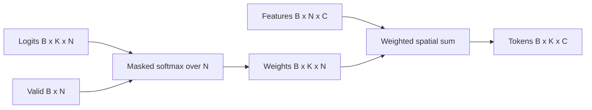

# Select Compact Visual Tokens with Learned Attention: theory

## Intuition

A visual encoder can emit many feature vectors even when the policy needs only a few summaries. One learned attention map may emphasize a gripper, another a nearby object. Each summary remains a soft mixture; it is not a hard top-k selection of locations.

## Axes and normalization

Write features as $F\in\mathbb R^{B\times N\times C}$ and supplied logits as $\ell\in\mathbb R^{B\times K\times N}$. $B$ indexes independent images, $N$ flattened spatial locations, $C$ descriptor channels, and $K$ compact tokens. All are dimensionless. Boolean $V\in\{0,1\}^{B\times N}$ identifies actual locations rather than padding.

For each $(b,k)$, let $m_{bk}=\max_{n:V_{bn}=1}\ell_{bkn}$. Define

$$
w_{bkn}=\begin{cases}\dfrac{e^{\ell_{bkn}-m_{bk}}}{\sum_{j:V_{bj}=1}e^{\ell_{bkj}-m_{bk}}}&V_{bn}=1,\\0&V_{bn}=0.\end{cases}
$$

Subtracting the same maximum from numerator and denominator leaves the ratios unchanged. It keeps every exponent nonpositive. An all-masked image has no valid maximum or positive denominator, which explains the contract’s rejection.

The aggregation is

$$
z_{bkc}=\sum_{n=0}^{N-1}w_{bkn}F_{bnc}.
$$

The feature-channel axis survives; only the spatial axis is summed. Weights are nonnegative and sum to one, so each output channel lies within the range of its valid input features. This gives a useful invariant for testing.

## Worked calculation

For feature vectors $(1,0)$ and $(3,2)$ with logits $0$ and $\log3$, the weights are $(1/4,3/4)$. Thus $z=(2.5,1.5)$. Adding $500$ to both valid logits leaves the result unchanged. A padded third vector with logit $99$ stays excluded; its score must not enter the denominator.

## Original shape diagram

Text alternative: a mask removes padded locations; each output token normalizes its own spatial logit row; those weights multiply the original feature vectors; summing locations preserves batch, token, and channel axes.

## Learning through the compressor

For one attention row, $\partial w_i/\partial\ell_j=w_i(\mathbf1[i=j]-w_j)$. Consequently

$$
\frac{\partial z_c}{\partial\ell_j}=w_j(F_{jc}-z_c).
$$

A valid location whose feature differs from the current summary can move the summary by changing its logit. A masked location has weight and gradient zero. Detaching weights would prevent the upstream logit network from learning where to look.

## Why this matters on a robot

Reducing token count can lower transformer work, but a summary may discard a tiny contact cue. Incorrect spatial-axis normalization silently mixes token roles, while mask mistakes let padded camera regions dominate. Inspect attention and small-object coverage before interpreting a faster encoder as an equally capable policy.

## Check your understanding

1. Why does adding one constant to a complete valid logit row leave its token unchanged?
2. Why is this a soft visual summary rather than hard top-k selection?
3. If a padded location contains a very large logit, where must it be excluded to avoid changing the output?

## Sources and prerequisites

[Primary paper](https://arxiv.org/abs/2212.06817) · [Implementation used to verify the mechanism](https://github.com/google-research/robotics_transformer/blob/4569641b8111f3f402c32d8e24becd2a6e952ecc/tokenizers/token_learner.py#L103-L117). This exercise isolates the spatial softmax and weighted aggregation in RT-1’s TokenLearner. Logits are supplied; learning their LayerNorm/MLP generator, image encoding, language conditioning, and policy training are out of scope. The optional padding mask is an original batching extension.

Prerequisite concepts: visual feature grids, attention weights, and the distinction between spatial and batch axes. No Python syntax or general mathematics lesson is required.
